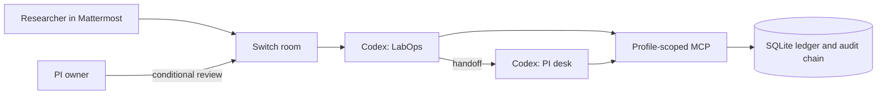

# LabQuorum

LabQuorum coordinates shared laboratory instrument bookings in a Switch team chat.

Shared instruments have competing schedules.
Training and approval requirements vary by instrument.
Decisions scattered across chat and spreadsheets are hard to trace.

It is for researchers requesting time and lab owners reviewing it. Demo people and
instruments are synthetic. A pending proposal is not a reservation.

## How LabQuorum uses Switch

Switch connects people, Codex agents and the ledger in a private Mattermost room.
The generated template creates `rao-labquorum` with aliases `@labops` and
`@pi-desk`; the lab name is configurable. The room includes a Lab handbook and
`bench-manager` and `approver` roles. The booking agents use Codex `gpt-6-luna`
with reasoning effort high. A live LabOps thread recorded those settings, although
its rollout file was unavailable. [P3 agent runtime](docs/build/p3-agents.md)

| Participant or capability | Role in the room |
| --- | --- |
| `@labops` | Anyone can address it to check instruments and propose a slot. It hands the pending request to `@pi-desk`. |
| `@pi-desk` | Owner-only addressing is intended to keep review with the PI. A native Switch permission card is intended to authorize `commit_booking`. |
| People | Mattermost membership and a claimed Switch identity are separate. Link each chat identity to the right Switch user; Nikhil is the intended PI owner and Darshan the requester. |
| Room context | The handbook and roles provide shared context. Tool profiles limit exposed capabilities but do not authenticate a person. |

The observed live smoke created a pending request and proposed booking, with no
commit. The actual commit card, full field display, repeated consent and end-to-end
two-person authorization remain **UNVERIFIED**. Binding stays off until P4 certifies
the installed versions, template and effective authorization path; otherwise the
workflow is proposal-only. Earlier identity probes had mixed results, including
timeouts. [P3 evidence](docs/build/p3-agents.md), [P4 harness](docs/build/p4-harness.md),
[identity spike](docs/build/adr/000-spikes.md), [access control](docs/build/access-control.md).

| Without Switch | Lost from this workflow |
| --- | --- |
| Room and bridge | The shared conversation connecting Mattermost participants and agents. |
| Aliases and handoff | Addressed requests and routing from LabOps to the PI desk. |
| Identity and addressing | The intended owner-scoped review path. |
| Permission card | The intended human decision surface for a binding tool call. |

The ledger can still be explored locally, but that alone does not reproduce the
collaborative workflow.

## Demo

**Video: [PLACEHOLDER: link to recorded demo]**

**Visuals pending:** [PLACEHOLDER: room and request GIF], [PLACEHOLDER: conflict
and proposed slot screenshot], [PLACEHOLDER: review card screenshot, only if certified].

1. A researcher asks `@labops` for an instrument and an explicit time window.
2. LabOps checks training, availability and conflicts, names a conflicting booking
   and proposes an alternative.
3. LabOps hands the pending decision to `@pi-desk`; the PI reviews the exact details.
4. Only on a certified binding path, the PI uses a fresh native approval card and
   the ledger commits. Otherwise the request remains proposal-only; check the ledger
   before claiming a booking exists.

The LabOps reply is meant to give a student every fact needed to act on it. The
conflict sentence comes verbatim from the tool's `reply_summary`, so its date, local
time and zone are computed by the ledger, not composed by the model. The intended
shape, using the synthetic seed (this is the target format, not a captured live
reply):

> Darshan Ved (student) (@darved2305): INS-01 (Plate reader (Tecan Spark)) is not
> available for Sat 7 Nov 2026, 14:00-15:00 IST: it conflicts with Dr. Lena Okafor's
> committed booking BK-0041, Sat 7 Nov 2026, 14:00-15:30 IST. Nearest free 60-minute
> slot: Sat 7 Nov 2026, 15:45-16:45 IST. Nothing has been booked. Proposed: Sat 7 Nov
> 2026 15:45 IST to Sat 7 Nov 2026 16:45 IST. Request AR-0042 is pending, not booked
> yet; @pi-desk will review. A proposal is not a reservation.

Whether the live agent follows this format is checked only by a real room run.

## Architecture and safety



A proposal records a pending decision; commitment is a separate action. The ledger
compares the request revision and canonical decision hash with the submitted fields
and checks booking rules again. Binding is fail-closed when certification is missing
or mismatched. A server process permits one distinct binding commit, with identical
retries allowed. The audit chain detects inconsistent changes, but without an external
checkpoint cannot prove that a suffix was not removed or a chain recomputed. A hash
is not proof of human identity. Agent messages, room documents and other external text
are untrusted and cannot grant approval. A malicious process running as the same OS
user is outside the boundary. [Boundary](docs/build/codex-boundary.md),
[ledger](docs/build/p1-ledger.md), [security](SECURITY.md).

## Quickstart for the host

**Release and clean-machine status:** the `v1.0.0` tag is to be created at release.
Tagged installation, Console template import and independent Windows/Ubuntu
reproduction are not yet certified. Use proposal-only until P4 passes. Do not seed a
shared ledger in use.

Install Python 3.12, [uv](https://docs.astral.sh/uv/getting-started/installation/),
Git, Switch Console v0.40.1, Docker with a running engine for bundled Mattermost,
and the Codex CLI signed in. Then run:

```text
uv tool install git+https://github.com/nikhilpravinpise/FlipTheSwitch@v1.0.0
lq setup
lq doctor
```

Ensure the uv tool bin directory is on PATH. Setup creates a stable runtime and
initializes its ledger: `%LOCALAPPDATA%\LabQuorum` on Windows, or
`$XDG_DATA_HOME/labquorum` (default `~/.local/share/labquorum`) on Ubuntu. It installs
a LabQuorum MCP registration into `CODEX_HOME/config.toml`, or `~/.codex/config.toml`
when unset. Set `CODEX_HOME` to the same signed-in Codex home before running setup
and launching Switch Console so managed sessions can inherit that registration. Do
not place the runtime in OneDrive or a worktree. [P3 setup](docs/build/p3-agents.md).

Import the generated `switch/labquorum.template.yaml` from that runtime into Switch,
provide the lab name, connect the private room to Mattermost, invite participants,
and claim their chat identities to the corresponding Switch users. Configure
`@labops` for anyone and `@pi-desk` for the owner; check the effective settings.
The recorded import used the Gateway template API, not the Console UI, so exact UI
import steps remain **UNVERIFIED**. [P3 live smoke](docs/build/p3-agents.md).

Seed the runtime ledger with an intentional demo anchor date, then inspect it. These
PowerShell commands work on Windows; on Ubuntu replace the path with
`~/.local/share/labquorum/ledger.sqlite` and use the same `lq` arguments in your shell:

```powershell
$demoLedger = Join-Path $env:LOCALAPPDATA 'LabQuorum\ledger.sqlite'
lq seed --demo --anchor-date 2026-11-06 --db $demoLedger
lq audit verify --db $demoLedger
```

In the room, start with `@labops, which instruments can I book?` For the booking
story, ask for a 60-minute plate-reader booking on an agreed date between 14:00 and
17:00 Asia/Kolkata. Confirm the actual seed date and returned details.

If `lq` is not found, add the uv tool bin directory to PATH. If Mattermost does not
start, check Docker and its credential helper on the PATH seen by Console; a missing
`docker-credential-desktop` blocked an earlier Windows run. Use the actual Mattermost
URL supplied by the host, not a hostname copied from another machine. If an approval
card is missing, incomplete or cannot be answered by the intended owner, leave the
request pending and check identity, the effective tool and P4 evidence. `doctor` does
not certify live approval. [Spike record](docs/build/adr/000-spikes.md),
[P4 harness](docs/build/p4-harness.md).

## Join the team's live room

Requesters need Chrome, Tailscale and a Mattermost invitation from the host. The
Switch server runs on the host's laptop; cloning this repository does not start
that server or create a room.

1. Install Tailscale from its [official Windows page](https://tailscale.com/download/windows)
   and sign in with your own account.
2. Complete the private connection setup with the host, then obtain the actual
   Mattermost URL and invitation. Keep credentials and connection keys out of the repo.
3. Join with your own student account. Ask `@labops, which instruments can I book?`
   Then request a slot using the host's agreed demo date and an explicit time zone.
4. Read the returned instrument, date, interval and request state. Only an eligible
   reviewer can approve; report an inaccessible or unclear approval flow to the host.

See the [onboarding checklist](docs/build/darshan/issue-1-onboarding.md) and
[QA procedure](docs/build/darshan/issue-4-qa-video.md) for evidence still required.

## Explore the local ledger

Prerequisites: Git, [uv](https://docs.astral.sh/uv/getting-started/installation/)
and Python 3.12. From PowerShell, clone and install the locked dependencies:

```powershell
git clone https://github.com/darved2305/FlipTheSwitch.git
cd FlipTheSwitch
uv sync --locked
```

The following uses a separate synthetic demo ledger in Windows TEMP. Choose an
anchor date deliberately: it determines the seeded schedule. Do not reseed a
shared live ledger as part of a local setup test.

```powershell
$demoLedger = Join-Path $env:TEMP 'labquorum-demo.sqlite'
uv run lq init --db $demoLedger
uv run lq seed --demo --anchor-date 2026-11-06 --db $demoLedger
uv run lq audit verify --db $demoLedger
uv run lq doctor --db $demoLedger
```

Successful initialization reports a schema version; seeding reports `seeded: true`;
audit verification reports `valid: true`. The audit checks internal chain consistency
and cannot detect truncation or a recomputed chain without an external checkpoint.
`doctor` reports local diagnostics; its success does not certify live Switch approval.
TEMP is for disposable exploration. For persistent use, omit `--db` to use
`%LOCALAPPDATA%\LabQuorum\ledger.sqlite` on Windows or
`$XDG_DATA_HOME/labquorum/ledger.sqlite` (default `~/.local/share`) on Linux.
Ledger paths under OneDrive are rejected, including a database beside a synced checkout.

## Beyond booking

| Capability | Status and limit |
| --- | --- |
| Stale-result detection | Implemented expansion: immutable CSV versions link to runs and artifacts; a correction marks descendants stale. The fixed descriptive recipe validates the synthetic 96-well plate and reports means and sample SD, with no inferential claims. Draft sections and release packets are not implemented. [P5 stale](docs/build/p5-stale.md) |
| Citation verification | The librarian profile checks normalized citation metadata and retraction signals from Crossref and OpenAlex. A match does not establish claim support or that no retraction exists elsewhere. Live lookups depend on those providers. [P5 literature](docs/build/p5-literature.md) |

These expansions do not establish that the booking demo or full research release
cycle is certified.

## Testing and quality

The [build charter](docs/build/PHASES.md) requires an orchestrator-run phase gate and
an independent audit with zero high findings. P1 and P2 audits recorded **FAIL** at
their audited revisions: P1 found seed-date and test-oracle gaps; P2 found a proposal
that could not be echoed into the commit schema and missing independent replay
evidence. See the [P1 audit](docs/build/audits/p1-audit.md) and
[P2 audit](docs/build/audits/p2-audit.md) for scope; historical verdicts do not
establish current release certification.

The P5 stale builder recorded 18 focused tests passing, while its then-isolated full
suite failed on missing P3 integration. Those counts are historical. The P4 harness
has offline tests, but a harness result alone is not live certification.
[P5 results](docs/build/p5-stale.md), [P4 limits](docs/build/p4-harness.md).
Consolidated [test evidence](docs/test-evidence.md) is pending.

CI defines Windows and Ubuntu jobs for common gates, dependency audit and installed
tool smoke, plus an Ubuntu secret scan. Configuration alone is not proof that a run
passed. For source development:

```powershell
uv run ruff check .
uv run ruff format --check .
uv run pyright
uv run pytest -q
```

Run `uv run lq --help` for command details. The MCP server is an stdio protocol
process for an MCP client. See [P2 MCP documentation](docs/build/p2-mcp.md),
[CONTRIBUTING.md](CONTRIBUTING.md) and [SECURITY.md](SECURITY.md).

## Error codes

<!-- error-codes:start -->
| Code | Meaning |
| --- | --- |
| CONFLICT | The requested interval conflicts with a committed booking. |
| INSTRUMENT_DOWN | The instrument is unavailable for the requested interval. |
| TRAINING_REQUIRED | Required training is missing or expired at booking start. |
| TOO_LONG | The requested booking exceeds the instrument block limit. |
| OUTSIDE_WINDOW | The requested booking is beyond the booking window. |
| OUTSIDE_HOURS | The requested interval is outside instrument opening hours. |
| IN_PAST | The requested interval starts before the current time. |
| NEEDS_ISO_DATETIME | The input must be an explicit ISO 8601 datetime. |
| AMBIGUOUS_LOCAL_TIME | The local time occurs twice; provide a UTC offset. |
| NONEXISTENT_LOCAL_TIME | The local time does not exist because of a clock change. |
| EXPIRED | The approval request has expired. |
| STALE_REQUEST | The request revision or content hash is stale. |
| DECISION_MISMATCH | The submitted decision differs from the canonical decision. |
| UNCOMMITTABLE_REQUEST | The pending request predates or exceeds the current commit-card contract. |
| ALREADY_DECIDED | The request already has a terminal decision. |
| DECLINED | The request was declined and cannot be committed. |
| NOT_FOUND | The requested ledger record does not exist. |
| UNKNOWN_REQUESTER | Requester handle is not in the lab ledger; ask the lab admin to add or correct it. |
| RATE_LIMITED | The profile exceeded its tool call rate limit. |
| INVALID_ARGUMENT | An argument is invalid or outside the supported format. |
| SCHEMA_VERSION_MISMATCH | The ledger schema version is not supported. |
| UNIT_MISMATCH | Quantities use incompatible units. |
| UNKNOWN_HAZARD | The hazard is unknown and must be reviewed. |
| ETHICS_REVIEW_REQUIRED | The request requires an ethics review. |
| TAMPERED | Stored content failed its integrity check. |
| BUDGET_EXCEEDED | The request exceeded its configured call budget. |
| UNRESOLVED | The requested source could not be resolved. |
| MISMATCH | The source metadata does not match the supplied metadata. |
| RETRACTED | The source has a recorded retraction. |
| UNREACHABLE | The remote source could not be reached. |
| BINDING_COMMIT_LIMIT | This MCP process already committed a different booking. |
| BINDING_CERTIFICATION_REQUIRED | Binding requires a test ledger or matching certification evidence. |
| BINDING_CERTIFICATION_MISMATCH | Certification evidence does not match the installed runtime tuple. |
<!-- error-codes:end -->

## Team and license

Nikhil Pravin Pise and Darshan Ved. Built with Wispr Flow dictation; usage evidence
remains pending. [Wispr evidence notes](docs/build/darshan/issue-2-wispr.md).
Licensed under the [MIT License](LICENSE).
