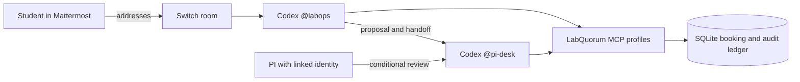

# LabQuorum

> Draft for a future release. Binding approvals, clean installation, template import and independent reproduction are pending their gates. Do not treat this draft as a verified installation guide.

LabQuorum is a booking workflow for shared lab instruments in a Switch team chat. A researcher asks `@labops` for a slot; the intended agent checks rules and suggests an alternative when there is a conflict. A PI reviews the exact decision through `@pi-desk` only after the installed approval path is certified. The baseline uses synthetic lab records and covers booking, training, requests and audit. Sources: `docs/plan/README.md`, `docs/build/PHASES.md`.

[PLACEHOLDER: demo GIF from an actual run, labeled with the certified or proposal-only outcome]

## How Switch is used

The intended room connects people and the Codex `gpt-6-luna` agents `@labops` and `@pi-desk` through Mattermost. Address `@labops` to request a booking; it hands the proposal to the PI desk. Nikhil is the intended PI owner, and Darshan the student on a separate chat account. Chat membership and a linked Switch identity are distinct; the student's refusal and PI's ability to answer must be verified on the chosen bridge. A native permission card is intended to show the complete decision for each binding action. Real two-person workflow and card certification are pending. Sources: `docs/build/team-impact.md`, `docs/build/PHASES.md`, `docs/build/codex-boundary.md`.



The binding path in the diagram is conditional on certification. The MCP profiles are exposure controls, not proof of identity. Source: `docs/build/audits/p2-audit.md`.

## Quickstart - planned release path

P6 requires a tagged clean install on Windows and Ubuntu, followed by setup and doctor. The tag, `lq setup`, generated template and clean-machine verification are pending; replace the placeholder only after the release gate passes. Source: `docs/build/PHASES.md`.

```powershell
uv tool install git+https://github.com/nikhilpravinpise/FlipTheSwitch@vX.Y.Z
lq setup
lq doctor
```

Then import the generated LabQuorum template in Switch Console, configure the Codex provider, connect the room and link each person's chat identity. Exact import steps, prerequisites and successful independent reproduction: **UNVERIFIED**; fill these in from the tested release before publishing. P6 places generated agent folders and ledger under a stable runtime root, outside a worktree. Sources: `docs/build/PHASES.md`, `docs/build/team-impact.md`.

## Security and limits

The intended binding design requires a complete decision card, a PI-owned approval path and at most one distinct binding commit per MCP server process, with identical retries allowed. Resetting the session is intended to require a fresh decision. Fail closed on missing certification, incomplete cards or failed checks; use proposal-only until all required checks pass. A hash does not authenticate the human, and a malicious process under the same OS user is outside the stated boundary. An audit chain without an external checkpoint cannot prove a suffix was not removed or a chain recomputed. Sources: `docs/build/codex-boundary.md`, `docs/plan/README.md`, `docs/build/audits/p1-audit.md`.

This is a booking-only baseline. Literature, analysis, inventory and protocols are deferred. Do not interpret synthetic data as lab results. Source: `docs/plan/02-product.md`.

## Testing and gates

Each phase requires an orchestrator-run gate and an independent audit with zero high findings. P1 includes coverage and race checks; P2 includes real MCP stdio inventory and round-trip checks; P4 certifies actual identities, cards and consent. The recorded P1 and P2 audits both returned FAIL, so do not infer release readiness from historical passing test counts. Sources: `docs/build/PHASES.md`, `docs/build/audits/p1-audit.md`, `docs/build/audits/p2-audit.md`.

## Team

Nikhil: intended PI and Switch agent owner. Darshan: intended student participant and blog author. The two-person demo and independent README reproduction are pending. Sources: `docs/build/team-impact.md`, `docs/build/PHASES.md`.
