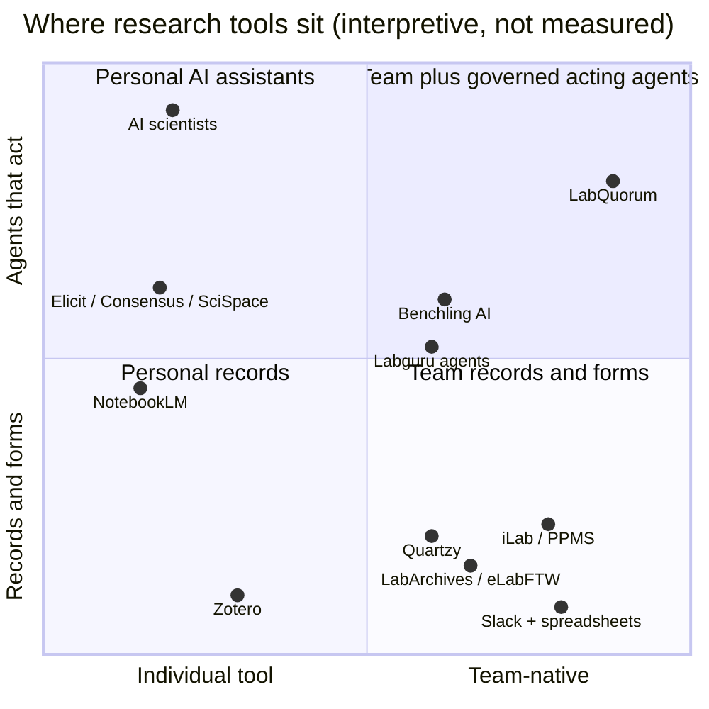

# 1. Problem, market and USP

Back to the [master plan](README.md). Sources are linked inline. "UNVERIFIED" means no primary source confirmed the claim during planning. Prices are public signals on 2026-11-04, not quotes; "third-party" means an aggregator figure.

## 1.1 The pain, with evidence

| # | Pain | Evidence | What it means for LabQuorum | What the evidence does not prove |
| --- | --- | --- | --- | --- |
| P1 | Researchers lose a large share of research time to administration | Federal Demonstration Partnership faculty workload surveys: about **42%** of PIs' federally funded research time goes to pre- and post-award administration, nearly unchanged 2005 to 2012 ([NAS FDP 2012 report PDF](https://sites.nationalacademies.org/cs/groups/pgasite/documents/webpage/pga_087667.pdf), [Berkeley summary](https://news-rac.berkeley.edu/2007/04/fdp-issues-report-on-faculty-burden.html)) | The legwork (scheduling, ordering, chasing, formatting) is what agents can draft, as long as a human still decides | US federally funded faculty only; not a 2026 measurement |
| P2 | Reproducibility is broken, partly because records are bad | Nature's 2016 survey of 1,576 researchers ([Baker 2016, Nature 533:452](https://www.nature.com/articles/533452a)). Opus read the figures (over 70% failed to reproduce others' work, over half their own) from the PDF; Codex found the page paywalled | Bench entries tied to protocol versions, dataset hashes, script hashes, stale-on-change | Quote the numbers only with the citation; they are a survey of perceptions |
| P3 | AI is everywhere in research, ungoverned and fragmented | Wiley ExplanAItions 2025 (2,430 researchers): 84% use AI (57% in 2024); 80% use mainstream chatbots, 25% use research assistants; 57% cite lack of guidelines; hallucination concern rose from 51% to 64% ([Wiley press release](https://newsroom.wiley.com/press-releases/press-release-details/2025/AI-Adoption-Jumps-to-84-Among-Researchers-as-Expectations-Undergo-Significant-Reality-Check/default.aspx)) | The gap is shared, governed, auditable AI with lab rules, not more private chatbots | Self-reported, publisher-run survey |
| P4 | LLMs fabricate citations | GPT-4o mental-health reviews: nearly 20% of 176 references fabricated, about two thirds fabricated or erroneous ([summary of the JMIR Mental Health study](https://www.gigazine.net/gsc_news/en/20251207-ai-generated-citations-fabrication-errors)); deep research agents hallucinate URLs at higher rates ([arXiv 2604.03173](https://arxiv.org/html/2604.03173v1)) | Citation checking must be deterministic code, not a prompt. Cheapest, most demonstrable trust feature | Rates depend on model and domain |
| P5 | Retracted papers keep being cited | Retraction Watch data is open through Crossref; the REST API exposes retractions in `update-to` with source `publisher` or `retraction-watch`, updated each working day ([Crossref blog](https://www.crossref.org/blog/retraction-watch-retractions-now-in-the-crossref-api/)) | A free, authoritative signal checked on every citation | Coverage is incomplete: "no retraction found" is not "never retracted" |
| P6 | Literature work is a weekly time sink | Elsevier survey coverage: about 4 h/week locating articles and 5 h reading ([phys.org](https://phys.org/news/2019-08-results-impact-volumes-workload.html)) | `@scout` cuts locating time and leaves reading to people | 2019 numbers; 2026 figures UNVERIFIED |
| P7 | Shared instruments are underused and hard to share | CU BioCore consolidation freed 2,115 sq ft of underused instruments; researchers avoid sharing due to training, scheduling, repair and contamination concerns ([CU submission](https://www.cu.edu/controller/i-e-awards/past-submissions/cu-ie-submission-establishing-multi-departmental-shared)) | Booking with training checks, maintenance status and a fair approval loop addresses the stated reasons | No hard utilization percentage found |
| P8 | ELN adoption fails on usability and workflow fit | 2026 single-institution study: barriers were insufficient user-friendliness (69%), familiarization effort (60%), technical difficulties (56%), workflow integration (46%) ([Jager et al., PLOS One](https://journals.plos.org/plosone/article?id=10.1371/journal.pone.0355558)); institution-wide ELN rollouts report cost, training and policy concerns ([PMC9014952](https://pmc.ncbi.nlm.nih.gov/articles/PMC9014952/)) | Do not build another app to adopt; meet the lab in its chat; export to the ELN it already has | One institution |
| P9 | Typing at the bench conflicts with lab work | A Nature Protocols ELN review names typing while wearing PPE as a usability issue ([Nature Protocols review PDF](https://www.nature.com/articles/s41596-021-00645-8.pdf)) | Voice-assisted bench logging with read-back ([05](05-wispr-flow.md)) | Voice is not right for every clean room or noisy space |
| P10 | Pressure and hierarchy undermine rigor | Wellcome survey of 4,000+ researchers: 23% of junior researchers reported pressure to produce a particular result ([Wellcome](https://wellcome.org/insights/reports/what-researchers-think-about-research-culture)) | Make decisions, exclusions and negative results explicit; never optimize for a positive finding | A tool does not fix culture |
| P11 | Core-facility tools exist but are institutional and heavyweight | iLab: enterprise scheduling, billing, inventory across 170+ institutions ([Agilent flyer](https://www.agilent.com/cs/library/flyers/public/iLab%20Solutions_5991-7935EN_Flyer_LR.pdf)); PPMS similar ([UC Davis PPMS](https://ppms.ucdavis.edu)) | A single lab's own instruments usually live in a spreadsheet. That is our wedge | |
| P12 | Labs are still mostly not digital | Cenevo's survey of 150+ labs: only 15% fully digitalized, 50% still rely on manual processes ([Lab Manager](https://www.labmanager.com/cenevo-introduces-new-ai-agents-to-reduce-manual-lab-work-34935)) | Plenty of room for a lightweight layer | Vendor-run survey |

### The pain in one story (used in the video voice-over)

Maya, a second-year PhD student, needs the plate reader Thursday afternoon for a biofilm assay. She checks the shared spreadsheet (stale), messages the lab manager on WhatsApp (busy), discovers on Thursday that crystal violet is nearly out, runs the assay a week late, pastes OD values into Excel, asks a chatbot for "three papers showing EGCG inhibits biofilm", and puts one in her committee report. It turns out to be retracted. Two weeks later she fixes a mislabelled well, but the figure in her draft still shows the old numbers. Nothing in that story needed a new model. It needed the existing people, tools and AI in one room, with rules.

### The job to validate

"When a project changes between a meeting and the bench, help us discover what is now invalid, get the right decision from the right person, and produce a result someone else can reproduce."

Validation plan (do not invent interviews): on Thursday, ask one reachable researcher for a 15-minute walkthrough of their last experiment (where was the question recorded, what changed, who approved it, where are raw data and exclusions, which tool would they refuse to replace). On Friday, ask them to try one LabQuorum task. Record only what actually happened. Success signals: completes without coaching; finds the current protocol in under 30 s; can name the approver of a booking; can trace a figure to its input data.

## 1.2 Competitor landscape (35 products)

The "misses" column is our reading of each product's public scope, not proof a vendor lacks a feature. Most incumbents are integration targets, not enemies.

### ELN, LIMS and lab operations

| Product | What it does | Price signal | What it misses for an academic PI group |
| --- | --- | --- | --- |
| [Benchling](https://www.benchling.com/ai) | R&D platform: notebook, molecular biology, registry, inventory. Benchling AI agents Deep Research, Compose, Data Entry and Ask went GA in Feb 2026; AI edits are labeled in audit logs (June 2026) ([release notes vol 1 2026](https://help.benchling.com/hc/en-us/articles/44313208618893-Release-Notes-Volume-1-2026)) | Academic notebook free ([academic](https://www.benchling.com/academic)); paid tiers sales-gated, third-party estimates $15k+/yr | Agents live inside Benchling's UI, not the team's chat; no identity-bound approval loop for a lab's own instruments; academic tier excludes inventory. **Strongest warning against an "AI notebook" pitch** |
| [LabArchives](https://www.labarchives.com/pricing) | ELN plus inventory and scheduler add-ons | Official: Professional academic $330/user/yr; ELN + Inventory $360; Scheduler add-on $35 | Forms, no agents in chat, scheduler with no conflict-resolution help |
| [Labguru (Cenevo)](https://www.labguru.com/) | ELN, LIMS, inventory, equipment, automation; Labguru Assistant; two agents (protocol conversion, automation) launched Feb 2026 ([R&D World](https://www.rdworldonline.com/cenevo-launches-two-ai-agents-for-lab-protocol-conversion-and-workflow-automation/)) | Quote; third-party $1,000-1,500/user/yr | Already spans the lifecycle, but enterprise-priced; AI is in-platform assistance, not a team of addressable agents with approvals |
| [LabVantage CORTEX](https://www.drugdiscoverynews.com/labvantage-rolls-out-ai-platform-to-modernize-laboratory-data-management-17053) | Agentic AI platform inside LabVantage LIMS (Mar 2026) | Enterprise | Regulated industrial LIMS; not an academic lab's chat |
| [eLabFTW](https://doc.elabftw.net/) | Free AGPL ELN with scheduler, inventory, API; Docker self-host | Free | Excellent record system, no agents, no chat. **Natural export target** (stretch) |
| [SciNote](https://www.scinote.net/) | Cloud ELN, inventory, compliance, reporting | Free individual; Premium by quote (third-party) | Team features are paid; no chat-native agents |
| [RSpace](https://www.researchspace.com/pricing) | Open-source (AGPL since 2024) research data platform with many integrations | Third-party academic team ~$5,000/yr (UNVERIFIED) | Slack/Teams integration is notifications, not acting agents |

### Equipment booking, core facilities, inventory

| Product | What it does | Price signal | What it misses |
| --- | --- | --- | --- |
| [Agilent iLab](https://help.ilab.agilent.com/en_US/45530-managing-a-core-overview/271614-managing-a-core-overview) | Core scheduling, booking rules by user type and training, billing, service requests | Institutional, quote | Built for core facilities, not a lab's bench instruments; no agents |
| [Stratocore PPMS](https://www.stratocore.com/) | Reservations, training requests, incidents, billing, utilization | Quote | Same: institutional forms |
| [Calira (formerly Clustermarket)](https://calira.co/blog/clustermarket-is-now-calira) | Equipment booking and lab operations | Third-party academic ~$150/yr (UNVERIFIED) | A booking calendar, not a coordinator; no literature or analysis loop |
| [Quartzy](https://www.quartzy.com/pricing) | Inventory, purchasing requests and approvals | Academia $50/month billed annually (official page) | Purchase approvals live in a separate app nobody reads in chat |

### Literature AI

| Product | What it does | Price signal | What it misses |
| --- | --- | --- | --- |
| [Elicit](https://elicit.com/pricing) | Search, screening, extraction, systematic-review workflows, research agent | Basic free; Plus $11/user/month annual (official, audience toggle matters) | Single-user; results do not flow into a protocol, booking or PI-approved draft |
| [Consensus](https://help.consensus.app/en/articles/10087865-subscription-plans) | Evidence-grounded answers, Deep reviews | Free; Pro $20/month or $144/yr (official) | Q&A, not a team workflow |
| [SciSpace](https://scispace.com/pricing) | PDF chat, literature review, writing, agents | Paid tiers; amounts UNVERIFIED | Individual workspace; credits |
| [scite](https://scite.ai/pricing) | Smart Citations (supporting / contrasting / mentioning), Assistant, MCP and API on higher tier | Basic $12/month, Pro $40/month billed yearly (official) | Great signal, not woven into a lab's drafting and approval loop |
| [Semantic Scholar](https://www.semanticscholar.org/product/api) | Free discovery and graph APIs; unauthenticated pool shared at 1,000 RPS; keys start at 1 RPS | Free | A data source; we use it (polish) |
| [ResearchRabbit (Litmaps)](https://learn.researchrabbit.ai/en/articles/12454495-what-is-researchrabbit) | Citation-graph discovery, collections | Free; RR+ paid by country | Discovery only |
| [Undermind](https://www.undermind.ai/) | Deep agentic search, reports, shared workspaces, agent connections | Free; Pro ~$16/month annual | Already collaborative; ends at a report, no downstream lab action |
| [NotebookLM / Gemini Notebook](https://support.google.com/gemininotebook/answer/16213268) | Source-grounded research notebooks | Free; higher limits on Google AI plans | Personal notebooks; no lab state. Re-check branding before the blog |
| [Gemini Deep Research](https://testingcatalog.com/google-debuts-deep-research-agents-on-ai-studio-and-apis/) and other deep-research modes | Cited multi-step reports, API with MCP | Google AI plans | General web research with URL hallucination risk |

### Writing

| Product | What it does | Price signal | What it misses |
| --- | --- | --- | --- |
| [Overleaf (with Writefull, AI Assist)](https://www.overleaf.com/user/subscription/plans) | Collaborative LaTeX, history, AI features | Free; Standard $25/month or $199/yr | Edits text; does not know which results were approved, which data produced them, or whether a citation is retracted. We export to it |
| [Paperpal](https://paperpal.com/pricing) | Academic editing, submission checks | Third-party Prime ~$19/month | Language quality is not experimental correctness |
| [Writefull](https://www.writefull.com/) | Language feedback widgets | Group licenses | Complementary copyediting |

### "AI scientist" systems

| System | What it does | Signal | What it misses for a real lab today |
| --- | --- | --- | --- |
| [Sakana AI Scientist v2](https://arxiv.org/pdf/2504.08066) | End-to-end computational ML research; one paper passed an ICLR 2025 workshop review then was withdrawn as planned ([TechCrunch](https://techcrunch.com/2025/03/12/sakana-claims-its-ai-paper-passed-peer-review-but-its-a-bit-more-nuanced-than-that)) | Open research system | Computational only; autonomy, not PI governance, is the design center |
| [Google AI co-scientist](https://research.google/blog/accelerating-scientific-breakthroughs-with-an-ai-co-scientist/) | Multi-agent hypothesis generation and ranking | Limited access | Hypotheses only; no bench, instruments or lab chat |
| [Edison Scientific Kosmos (FutureHouse spinout)](https://edisonscientific.com/) | Autonomous discovery runs with code- and citation-linked conclusions; $70M seed ([SiliconANGLE](https://siliconangle.com/2025/12/18/edison-scientific-raises-70m-build-autonomous-ai-scientists-research)) | Third-party ~$200/run (UNVERIFIED) | A batch "run", not daily coordination. FutureHouse itself notes no system has cleared a strong autonomous-discovery bar ([FutureHouse](https://www.futurehouse.org/ai-scientist)) |
| [Agent Laboratory](https://github.com/SamuelSchmidgall/AgentLaboratory) | Specialist agents for literature, experiments, reports (EMNLP 2025 Findings) | Open source | Strong conceptual overlap in role names; a pipeline, not a governed team space with physical resources |
| [Biomni / Phylo](https://phylo.bio/announcement) | General biomedical agent, 300+ tools, $13.5M seed Feb 2026 | Pharma deals | Computational biology workspace, not the lab's operational coordinator |
| [Potato](https://www.biopharmatrend.com/post/1213-potato-grows-45m-to-automate-lab-work-with-ai-and-robots) | AI co-scientist for protocols, analysis, automation scripts | Startup | Protocol generation without a lab-wide approval and resource layer |
| [Lila Sciences](https://www.lila.ai/tech) | Scientific models and autonomous "AI Science Factories"; ~$550M raised 2025 | Industrial | Replaces the lab rather than helping the lab that exists |
| [Periodic Labs](https://periodic.com/) | Autonomous materials labs; $300M seed | Industrial | Same |
| [DOE FORUM-AI (LBNL)](https://www.labmanager.com/doe-launches-agentic-ai-platform-to-accelerate-energy-materials-discovery-34920) | Government agentic platform for materials research with inspectable reasoning traces (Feb 2026) | Public research | National-lab infrastructure, not a university PI group's daily tool |

### What labs actually use

| Tool | Role | Price signal | What it misses |
| --- | --- | --- | --- |
| Slack | De facto lab chat; free plan keeps 90 days ([plans](https://slack.com/pricing)) | Pro ~$7.25/user/month (third-party) | Bots are not addressable, policy-bound team members with approvals. Switch bridges Slack later |
| Notion | Wikis, booking and inventory databases ([plans](https://www.notion.com/pricing)) | Free and paid seats | The lab must invent and enforce its own state transitions |
| Google Sheets | Booking and inventory sheets ([product](https://workspace.google.com/products/sheets/)) | Free / Workspace | No conflict, training or approval rules unless hand-built |
| [Zotero](https://www.zotero.org/storage) | Reference manager; 300 MB free, 2 GB $20/yr, unlimited $120/yr | Official | No verification of what an AI pasted; we export BibTeX/CSL JSON into it |
| WhatsApp / Telegram groups | Where coordination actually happens on phones | Free | No structure. Switch bridges Telegram, which we use for the bench room (polish) |

## 1.3 Gap analysis

| Capability | ELN/LIMS | Booking/core | Literature AI | AI scientists | Chat + sheets | **LabQuorum** |
| --- | --- | --- | --- | --- | --- | --- |
| Lives in the team's existing chat | No | No | No | No | Yes | **Yes (Switch bridges Mattermost, Slack, Teams, Discord, Telegram)** |
| Several specialist agents, each addressable with its own policy | No | No | No | Internal only | No | **Yes** |
| Human approval bound to an identity, visible to the team | Partial (sign-off) | Partial | No | No | No | **Yes (Switch approval cards, "Chosen by")** |
| Approval bound to an exact revision; changes invalidate it | Partial | No | No | No | No | **Yes (revision + hash; stale cascade)** |
| Deterministic citation and retraction verification before drafting | No | No | Partial | Partial | No | **Yes, enforced in code** |
| Lab-scale resources: instruments, training, inventory, hazards | Partial | Yes | No | No | No | **Yes** |
| Analysis with provenance (recipe or script hash, data hash) | Partial | No | No | Yes | No | **Yes** |
| Cost for a 10-person lab | $$$ | $$$ | $ per seat | $$$ | $ | **Free and self-hosted (plus the lab's AI subscriptions)** |

No claim of an empty quadrant or a durable moat: Benchling, Labguru and LabVantage all shipped in-platform agents in 2026. Our position is **high accountability with bounded autonomy, inside the chat the lab already uses, at academic cost.**

## 1.4 Unique selling point

**"Agents do the legwork in the room; the PI's click makes it real."** Four differentiators, each demonstrated on camera:

1. **The workspace is the lab's chat.** Mattermost today; Slack, Teams, Discord or Telegram via the same Switch bridges. The new behavior is "add an @mention", not "adopt an app".
2. **Authority is structural, not prompted.** Proposer agents physically lack commit tools. The gate agent's commit tools raise Switch approval cards that only the PI may answer. A prompt injection cannot click a button.
3. **Consent is bound to exactly what was approved.** An approval covers one request revision and hash. Change the data and every dependent figure, paragraph and packet goes stale until re-run and re-approved (the "consequence-aware" lab).
4. **Trust is computed, not asserted.** Citations pass a deterministic verifier (DOI resolves; title, first author and year match; not retracted; version of record noted) before any draft accepts them. Numbers in drafts come from recorded runs.

### Why chat-native multi-agent plus human approvals is the right shape

- **Labs already coordinate in chat.** The PI, student and lab manager negotiate changes together and each can see why work stopped.
- **Several narrow agents beat one omnipotent agent** for least privilege, for cost (cheap agents for cheap jobs) and for legibility (the room shows who did what). Switch addressing makes "the others do not act" a platform guarantee.
- **Approvals belong where the context is.** The PI sees the request, the justification, the conflict and the alternative in the same thread they click Allow in, and the lab sees the outcome.
- **AI-scientist systems aim to remove humans; academic labs are required to keep them** (PI responsibility, biosafety, IRB). Governance is the feature.

### What we deliberately do NOT build

| Not building | Why |
| --- | --- |
| A full ELN, LIMS, or 21 CFR Part 11 compliance | Incumbents do it; we export (eLabFTW stretch) |
| Our own chat client, web dashboard or dossier app | Switch plus Mattermost is the UI; a second UI dilutes "would it stop working without Switch" |
| Autonomous experiment execution or robot control | Unsafe, out of scope; physical work stays human |
| Our own model, fine-tuning, vector database | Bring-your-own provider via Switch; structured ledger beats embeddings here |
| Institutional procurement, billing, iLab/PPMS integration | Institution-specific; we draft orders and never claim to book a real core resource |
| Storing human-subjects data | Blocked by policy in the ledger ([07](07-edge-cases.md)) |
| A custom scheduler, control plane, multi-tenant SaaS, SSO | Not needed for the workflow; manual rituals first |
| A Wispr speech pipeline | Wispr Flow is the user's dictation layer; we never process audio |

### Long-term hypothesis (not in the pitch as fact)

A lightweight coordination layer a PI or department adopts on top of the chat and records systems it already has. Pricing and willingness to pay are UNVERIFIED; no revenue projections appear in the submission.
