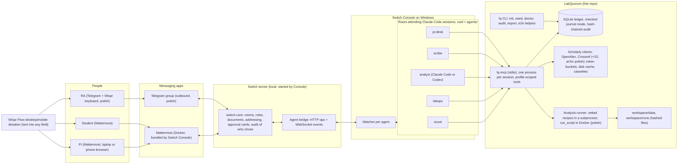
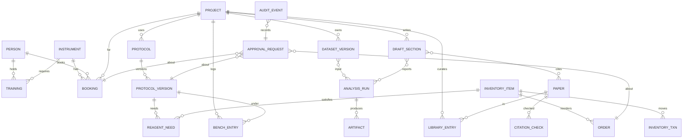

# 3. Architecture and Switch centrality

Back to the [master plan](README.md). Every choice is justified against the user's standing principles: quality, simplicity, robustness, long-term maintainability; reuse before building; no machinery without a concrete need.

## 3.1 Components



How the pieces connect (grounded in the Switch source and docs):

- Console starts each agent session and gives it the Switch skill and Switch tools through an MCP server on loopback; the agent CLI holds no Switch credentials; credentials live in `.switch/agents/<name>.json` (mode 600, gitignored by Switch) ([sessions and the runtime](https://docs.switchagents.ai/switch-rooms/internals/connectors-and-runtime.md)).
- The Claude adapter starts Claude Code with `cwd` set to the agent's directory and adds allow rules for all host-registered MCP servers; other project-configured MCP servers and project settings require an installed-version permission test ([claude-adapter.ts](https://github.com/sandbox-quantum/switch/blob/main/console/packages/agent-providers/src/claude/claude-adapter.ts)). So each agent folder's `.mcp.json` and `.claude/settings.json` should apply. **This is spike S2, the most important Day-1 check.**
- Claude Code `ask` decisions reach the adapter's `canUseTool`, which Switch posts as a room card with "Allow once", "Allow for this session" and "Decline"; settled cards read "Chosen by <actor> from Mattermost" ([adapter](https://github.com/sandbox-quantum/switch/blob/main/console/packages/agent-providers/src/claude/claude-adapter.ts), [settled-card test](https://github.com/sandbox-quantum/switch/blob/main/core/tests/switch_core/bridges/collaboration/test_session_settled_cards.py)); installed end-to-end testing remains required.

### Technology choices

| Choice | Alternatives | Why |
| --- | --- | --- |
| **Python 3.12 + uv** (lockfile) | Node/TypeScript | The analysis stack (pandas, scipy, statsmodels, matplotlib) is Python anyway; one language for ledger, MCP, recipes and tests; `uv` gives fast reproducible installs on Windows |
| **SQLite, `BEGIN IMMEDIATE`, 5 s busy timeout, under `%LOCALAPPDATA%\LabQuorum`** | Postgres in Docker; JSON files | One file and transactional, with backup and recovery work. Room sessions may start multiple MCP processes, so writes are short immediate transactions; never in OneDrive (live SQLite corruption risk) |
| **MCP server (stdio) built with the official `mcp` Python SDK (FastMCP), one profile per agent** | Agents shell out to a CLI; an HTTP service | Typed tool schemas the agent sees; Claude Code permission rules match tool names (`mcp__lab__commit_booking`), so approval attaches to exactly the dangerous tool; a profile's missing tools simply do not exist. Pin `mcp<2` and test v1 FastMCP with a real stdio list-tools and gated round trip; stdout is JSON-RPC only, logs go to stderr |
| **httpx + per-host token bucket + on-disk response cache** | requests; no cache | Async, timeouts, `Retry-After`; cache keeps demos fast and budgets safe |
| **pytest-recording (VCR.py) cassettes, respx for fault injection** | Live APIs in CI | CI never depends on OpenAlex or Crossref uptime or budgets |
| **rapidfuzz** for title matching | difflib | Fast, well-tested token-set ratios |
| **pint** for units | Hand-rolled | Unit mismatch must fail, not silently convert |
| **pandas and matplotlib; scipy and statsmodels only for separately validated future recipes** | R | Deferred; require golden tests before enabling the agent to use the recipe |
| **structlog JSON lines** | print | Correlated logs per request id |
| **Pandoc if present, else Markdown + PNG** | A full TeX install | TeX on Windows is a time sink; `render_document` says "pandoc not found" loudly |
| **No web dashboard** | Streamlit, Next.js, a Jinja dossier | A second UI competes with Switch for the 30% criterion; readable chat snapshots expose ledger state; room documents provide agent context and metadata |

## 3.2 The two-layer approval model

This is the heart of the product and the biggest technical risk, so it has a primary design, explicit guards, a test for each guard, and a fallback.

**Layer 1, Switch and provider (who decided):** Switch resolves the human identity and checks addressing. The native card is an externally enforced provider boundary; the ledger does not receive an authenticated approval receipt. Direct same-OS-user invocation is outside this prototype's boundary. An unprompted in-scope commit is a release blocker. The MVP uses one authorized human, not a multi-person quorum.

**Layer 2, ledger (what is executed):** Every gated call carries request id, revision, hash and canonical structured `decision` containing action, requester, resource, absolute interval or quantity, and relevant protocol/run fingerprint. The transaction compares the whole decision and canonical hash with stored bytes, checks pending state, expiry and current policy, then commits once. Keep serialized input below 900 characters and verify every critical field on the real card; if it cannot fit or a critical field is truncated, refuse the commit. An attachment is not an approved fallback in the core: its visibility and binding are unverified. A model summary is not evidence of what was approved. A changed quantity produces a new revision and fresh decision. Final release additionally binds the current packet fingerprint.

| Guard | Required real-runtime test |
| --- | --- |
| Addressing and control plane | In a disposable room reproduce a helper calling `update_agent_detail` on pi-desk to widen addressing; then deny `mcp__switch__update_agent_detail` on every agent, disable management capabilities and audit all offered Switch mutations. Repeat: zero policy changes and zero unauthorized commits. |
| Public tools | Clean Windows account; inventory effective native, MCP and plugin tools. Deny Bash, PowerShell, Read, Glob, Grep, Write, Edit, NotebookEdit, WebFetch, WebSearch, delegation and unapproved MCP tools; verify harmless PowerShell write and dummy sibling credential read both fail without an approvable escape card. Reviewed attachment staging remains a separate Switch host path. |
| Session permission | On the same provider session and same commit tool, approve request 1 for session, complete it, then call request 2 with different payload. Two distinct cards and request 2 pending until its own decision; repeat 3 times. [Permission precedence](https://code.claude.com/docs/en/permissions) is a hypothesis until this passes. |
| Auto, bypass and hook failure | Pin Claude Code >=2.1.295 with supported command-hook `onFailure: block`, 5-second timeout and generated absolute executable/project paths, properly quoted for spaces. Hook allows `ask` only in explicitly certified normal modes and denies bypass, dontAsk, auto and unknown modes. Test missing executable, exit 1, malformed JSON and timeout under bypass: zero commits. If failure blocking cannot be proved, fail startup and disable commits. [Hooks](https://code.claude.com/docs/en/hooks). |
| Effective configuration | Doctor detects managed vs Console-run, inspects the discovered active local configuration or authenticated human Console/server settings and revision for managed agents. Unknown or ambiguous fails. Test safe and bypass for both types; no human credential goes to models. |
| Decision contents | Swap resource/time/quantity or describe A while submitting B: transaction rejects mismatch or actual card visibly shows B, never a misleading opaque hash. All critical fields visible without truncation. |
| Decline | Native Decline refuses the attempt; the domain request stays pending until independently recorded declined or expired. Kill session before follow-up on 3 runs: no execution without fresh authorized decision. |
| Injection | Mediated commits require an authorized human; proposals and summaries can still be corrupted. Test six argument/handoff attacks including instrument, quantity and evidence substitutions plus legitimate controls; report actual effects, not a universal security rate. |

Record Console/server/Claude CLI versions, OS, hook, effective settings hashes and revision, room/tool-use IDs, request revision/hash, card and ledger outcome in ADR-000 and `docs/test-evidence.md`. Untested tuples fail preflight. The provider must be recertified after changes. Native card flow ships only after S2/S3a-d, bypass, failure and restart tests pass. Certification is UNEXECUTED; [08](08-build-schedule.md) allocates a distinct 120-minute block after the behavioral-red harness and implementation, separate from E2E execution. Before S1/S3 its S4 fixture provisions a disposable room with two claimed test identities, enrolls them and proves both can post. Do not enable commits if either allocation or fixture is absent. In certification, capture the tuple, full card screenshots, identities and ledger outcomes. Pass only if every guard above passes, including three repeated same-session pairs and zero unauthorized commits. On any failure, timeout or missing evidence disable commits and use proposal-only, unless a separately scheduled and fully certified steward passes. This cap is an estimate, not measured runtime; record elapsed time.

### Decision rules after the spikes

| Result | Decision |
| --- | --- |
| Settings and MCP discovery pass, full card certification passes | Use the native card; each request requires a fresh PI decision. |
| Settings pass but MCP launch alone fails | Try a separate gate-only CLI settings profile without blanket Bash deny, with exact gated commands and shell-composition tests; rerun the entire card/session/bypass suite. Public helpers retain shell deny. |
| Settings enforcement fails, or repeated cards fail | Disable commits or select the separately certified steward. A Bash rule in the same ignored settings cannot fix settings loading. Allocate 3-5 h by cutting optional work; decide by Thursday morning. |

Steward fallback: PI configures addressing in Console/Gateway before start; self-update is forbidden. Discover installed operation schema and use operation spelling rather than template shorthand. Verify enrolled opaque human sender, addressed message, exact id/revision/hash/expiry and one-use decision. Open WebSocket with `rooms=<room IDs>`, stable `connection_id`, numeric `start_from`, and `expected_generation`; use returned rooms/cursor/generation. A dedicated reader pongs with durably processed cursor. Stop on `taken_over`; pause mutation on gaps until reconciled. Atomically persist inbox, decision, domain effect and outbox receipt; retry receipt using stable ID. Test dropped socket/replay, crash after commit, gap, stale generation/takeover and slow job >6 seconds: exactly one effect and eventual receipt per case. The transport and replay contract is documented in the [protocol](https://docs.switchagents.ai/switch-rooms/internals/agent-protocol); the ledger, authorization and exactly-once effects are proposed application behavior and remain unverified. Do not claim this branch works before its tests.

## 3.3 Data model and invariants



| Entity | Key fields | Invariants (each has a test) |
| --- | --- | --- |
| `person` | `id`, `handle`, `display_name`, `role` (pi, postdoc, student, ra, lab_manager, safety, external), `tz` (IANA) | Handles unique case-insensitively |
| `instrument` | `id`, `name`, `aliases`, `location`, `requires_training`, `max_block_minutes`, `min_gap_minutes`, `status` (ok, down, down_until), `booking_window_days`, opening hours | A down instrument rejects proposals and commits |
| `training` | `person_id`, `instrument_id`, `granted_at`, `expires_at` | Valid at the booking's **start**, checked at proposal and again at commit |
| `booking` | `id`, `instrument_id`, `person_id`, `project_id`, `start_utc`, `end_utc` (half-open), `status` (proposed, committed, cancelled, expired, declined), `request_id` | No two committed bookings overlap including `min_gap`; checked inside the commit transaction (`existing.start < new.end + gap AND existing.end + gap > new.start`); property-tested |
| `inventory_item` / `inventory_txn` / `order` | `qty` + `unit` (pint), `reorder_threshold`, `pack_size`, `hazard_classes` | Quantity never negative; incompatible units fail; orders round up to pack size; holds released on cancellation, consumed stock stays consumed with an audit entry |
| `protocol_version` | `protocol_id`, `version`, `body_md`, `sha256`, `hazards`, `required_training`, `status` (draft, in_review, released, superseded) | Exactly one released version per protocol; released is immutable (hash checked on load, `TAMPERED`); ethics keywords require an ethics reference before release |
| `bench_entry` | `project_id`, `person_handle`, `observed_at`, `confirmed_at`, `text_original`, `parsed_json`, `protocol_version_id`, `source`, `message_ref`, `supersedes` | Record `performed_protocol_version` and current-project acceptance separately; preserve historical versions; append-only (corrections supersede, never overwrite); confirmed only with a matching unexpired token |
| `dataset_version` | `dataset_id`, `version`, `path`, `sha256`, `bytes`, `schema_json`, `sensitivity` (internal, unpublished, human_subjects), `registered_by`, `supersedes` | Raw bytes immutable; `human_subjects` cannot be staged |
| `analysis_run` | `inputs` (dataset version hashes), `recipe` + `recipe_version` or `script_sha256`, `env_lock_sha256` or image digest, `params_json`, `outputs_json` (with hashes), `status`, `stale_reason` | Outputs referenced by drafts must exist with matching hashes; status CURRENT -> STALE, never silently back |
| `paper` / `citation_check` | DOI (lowercase), OpenAlex/S2/arXiv/PMID ids, `is_retracted`, `retraction_doi`, `version_of_record_doi`; verdict enum, `evidence_json`, `checked_utc` | Verdicts are computed only by `verify.py`, never by an agent |
| `draft_section` | `text`, structured `library_entry_ids`, numerical claims with `run_id`, `metric_path`, `value`, `unit`, `rounding`, `protocol_version_ids`, `parents_fingerprint`, `status` (current, stale) | Render numerical claims from run JSON; reject missing or stale evidence; bibliographic match and human claim-support review are separate |
| `approval_request` | `id` (`AR-0042`), `kind`, `payload_json`, `revision`, `content_hash`, `requested_by_agent`, `requested_for_handle`, `room`, `thread_ref`, `status` (pending, committed, declined, expired), `expires_utc`, `decided_utc` | Lifecycle only pending -> committed / declined / expired; idempotent commit; revision and hash must match; the human identity of the approver is Switch's record (the ledger stores the thread permalink, never trusts a claimed name) |
| `audit_event` | `seq`, `ts_utc`, `actor_agent`, `tool`, `args_json`, `result_json`, `prev_hash`, `hash` | Append-only; `hash = sha256(prev_hash + canonical_json(row))`; `lq audit verify` detects unrechained edits, not recomputed chains or truncation |

All times are stored in UTC from one clock (the MCP host), displayed in each person's zone. Every mutation carries an idempotency key. Tools take ISO 8601 datetimes only: "Thursday 2 to 5 pm" is resolved by the agent and echoed back as an absolute date for confirmation; the tool returns `NEEDS_ISO_DATETIME` for anything else.

### The stale cascade (consequence-aware coordination)

The dependency chain is small and known, so it is implemented directly, not as a generic workflow engine:

```text
protocol_version, dataset_version, recipe/params
        -> analysis_run -> artifact (figure, table)
                        -> draft_section -> results packet
```

Each node records its parents' fingerprints. Registering a corrected dataset (a new `dataset_version` that supersedes the old one), or changing a recipe version marks every descendant `STALE` with the reason ("DS-0003 v2 supersedes v1: well C5 corrected"). If release enforcement is implemented and passes the full cycle, `finalize_packet` refuses while anything in the packet is stale; `draft_put_section` refuses to cite stale runs; `@analyst` and `@scribe` say what is stale and what to re-run; old versions stay readable with a stale mark. Re-running produces new ids; nothing becomes current again silently.

### Where state lives

| State | Authority | Access |
| --- | --- | --- |
| Conversation, membership, roles, room documents, approval decisions and who chose | Switch (and Mattermost) | Switch tools and Console only; we never touch Switch's database |
| Lab facts: bookings, inventory, protocols, bench log, datasets, runs, library, requests, audit | LabQuorum SQLite ledger | Only through MCP tools (profile-scoped) and the `lq` CLI |
| Files: CSVs, run folders, figures, drafts, PDFs | `workspace/` with hashes in the ledger | Raw inputs read-only; outputs hashed |
| Agent provider sessions | Console and the provider | No homegrown supervisor |
| Secrets | `.env` (gitignored), Console | The MCP server reads them; agents never see keys in prompts |
| Dictation | Wispr Flow (user's desktop app) | Not our backend |

## 3.4 Scholarly APIs and budgets

| API | Tier | Limits (primary source, checked 2026-11-04) | Client policy |
| --- | --- | --- | --- |
| [OpenAlex](https://help.openalex.org/how-to-use-the-api/rate-limits-and-authentication) | Deferred | 10 rps without a key, 30 rps with a free key; daily budget in credits ($1/day with a free key); **new accounts spend their first $1 at up to $0.10 per 5 minutes**; cursor paging beyond page one needs a key ([pricing](https://help.openalex.org/access/pricing/)) | Create the key early and measure remaining budget and pacing before use; 8 rps bucket; 20 results per query, max 3 queries per request; watch remaining-budget headers; cache everything |
| [Crossref REST](https://www.crossref.org/blog/announcing-changes-to-rest-api-rate-limits/) | Deferred | Public pool: 5 rps singleton, 1 rps list, concurrency 1. Polite pool (`mailto`): 10 rps singleton, 3 rps list, concurrency 3 | Always send `mailto` from `.env`; semaphore 3; 8 rps singleton, 2.5 rps list; honor `Retry-After`. Retractions via `update-to` (source `publisher` or `retraction-watch`) |
| [Semantic Scholar](https://www.semanticscholar.org/product/api) | Polish | Unauthenticated: 1,000 rps shared by all users; keys start at 1 rps | 0.9 rps keyed; tolerate 429 |
| [arXiv](https://info.arxiv.org/help/api/tou.html) | Polish | One connection, at least 3 s between requests | Global 3.1 s spacing; preserve versions |
| [PubMed E-utilities](https://www.ncbi.nlm.nih.gov/books/NBK25497/) | Stretch | 3 rps without key, 10 rps with key | 2.5 rps keyless |
| [Unpaywall](https://unpaywall.org/api/v2) | Stretch | Email required, under 100,000 calls/day; the search endpoint was retired Sep 18, 2026 (DOI lookup still works) | Only for library papers; never circumvent paywalls |

The scholarly adapters in this section are deferred: the funded booking-only core makes no scholarly requests and makes no general private-text refusal or zero-outbound-private-bytes claim. If separately scheduled, implement and test the bounded source-flow guard below; model-generated text can bypass source labels and must not be described as tracked. [CaMeL](https://arxiv.org/html/2503.18813v1) motivates enforcement outside the model but does not prove this design secure.

Client rules: 10 s per-request timeout; max 3 attempts for safe GETs with exponential backoff, jitter and `Retry-After`; 5 consecutive 5xx open a 60 s circuit and return `UNREACHABLE`; a single tool call making more than 50 HTTP requests fails with `BUDGET_EXCEEDED`; cache TTLs 7 days for search, 30 days for DOI metadata, 1 day for retraction status; every response shown with `checked_at`; cached results labeled with their age. Queries over 300 characters are refused; this is a size limit, not a privacy guarantee. Restrict the prototype to declared synthetic/public data. Roadmap, 1.5-2 h only if separately scheduled and tested: source-flow guard: server labels public-library and private-dataset records; scholarly adapter accepts only public identifiers/metadata and rejects private or mixed-source IDs. This does not track arbitrary model text. Test short model-generated private text, mixed-source IDs, and public inputs at the actual adapter boundary; reject unsafe or unclassifiable input rather than claiming arbitrary text is tracked. We fetch metadata and open-access links, never paywalled PDFs.

## 3.5 The deterministic citation verifier

Input: a claimed citation (DOI and/or title, first author, year).

1. Normalize the DOI (lowercase; strip `https://doi.org/`, `doi:`; trim trailing punctuation; decode URL-encoded slashes).
2. With a DOI: Crossref `works/{doi}`. On 404, one OpenAlex lookup by DOI (covers DataCite DOIs such as Zenodo); still missing gives `UNRESOLVED` as of the check date.
3. Without a DOI: OpenAlex title search; best match by `rapidfuzz.token_set_ratio` on normalized titles (Unicode NFKC, accents folded, LaTeX and HTML stripped); no candidate gives `UNRESOLVED`.
4. Use fuzzy matching only to retrieve candidates. Require exact normalized full title or a separately calibrated conservative full-string match; title subset, negation and ambiguous discrepancies require `NEEDS_REVIEW`. Compare: first-author surname match (accent and case folded); year within 1 (online vs print). Any failure gives `MISMATCH` with a field-level diff.
5. Retraction: Crossref `update-to` of type retraction (either source) or OpenAlex `is_retracted` gives `RETRACTED` with the notice DOI. Corrections and expressions of concern give `VERIFIED_WITH_NOTE`.
6. Versions: a preprint with a published version (Crossref `is-preprint-of` or OpenAlex locations) gives `VERIFIED_WITH_NOTE` with the version-of-record DOI.
7. Network failure after retries gives `UNREACHABLE`, never `VERIFIED`.

The supported draft format uses structured library-entry IDs, rejecting unresolved references and unsupported citation syntax. Separate identifier existence, bibliographic match, source text inspected and human-reviewed claim support. A DOI match never establishes support. Report "metadata matched; no retraction signal found in checked sources as of DATE; claim support not established". General recall is unmeasured. Retraction-check snapshots are parents of affected sections; finalization requires a successful fresh check within 24 h. A new retraction blocks the claim without rerunning unrelated numerical analysis.

## 3.6 Analysis execution

This entire analysis path is deferred and requires a separately scheduled implementation and tests; the booking-only baseline has no analysis tools.

`@analyst` is addressable by anyone, so it has no shell and no file tools. The LabQuorum server runs the work:

| Tool | Tier | Runs | Isolation |
| --- | --- | --- | --- |
| `run_analysis(dataset_versions, recipe, params)` | Deferred | Proposed vetted recipes: `descriptive`; inferential recipes require an independently designed valid fixture and remain roadmap | Our code in a subprocess with a 120 s wall clock; process tree killed with `taskkill /T /F` on Windows; requires golden tests before use |
| `run_script(run_id, code)` | Polish (cut line B) | Agent-written Python | `docker run --rm --network none --read-only --user 1000 --cap-drop ALL --memory 1g --cpus 1 --pids-limit 128`, mounting only `runs/<run_id>` (read-write, size-capped) and the staged dataset (read-only); pinned image built from the lockfile; ledger, `.env`, repo and user profile never mounted. Docker is not a complete defense against a hostile host; the README says so |

Every run records recipe name and version (or script hash), input hashes, output hashes, parameters, `uv.lock` hash or image digest, and timings. Matplotlib uses a fixed style module (sizes, fonts, colorblind-safe palette, labeled axes with units) and a fixed random seed where relevant. The experimental unit is explicit in each recipe (for the plate assay: wells within a plate are technical replicates unless the protocol says otherwise; the recipe reports technical well counts and descriptive spread only, without p-values, inferential intervals or biological efficacy claims).

## 3.7 Artifacts

| Artifact | Format | Delivered |
| --- | --- | --- |
| Figures | PNG (300 dpi) + SVG | Switch `send_attachment` into the thread (certify installed outbound cap; inbound host cap is 10 MiB in reviewed version) |
| Statistics | Markdown table in the message (Mattermost renders tables) + CSV | Message + attachment |
| Draft | Creator-owned room document plus versioned Markdown | Scribe posts readable attachment; listing documents exposes metadata only |
| Results packet | Minimal release record is conditional on the full tested stale-release cycle; optional ZIP includes input data, exact recipe source, lockfile, parameters, runtime versions, outputs, tolerances and tested reproduction command, plus sanitized decision/run timeline and synthetic label | Attachment after `finalize_packet`; acceptance requires unpacking in a clean environment, running the included command, comparing every reported number to its declared tolerance, and checking failed/rejected runs and exclusions in the timeline |
| Lab state digest | Creator-owned room document and readable status | `@labops` posts current snapshot in chat |

## 3.8 Observability, secrets, threat model

- **Logs:** structlog JSON lines from the MCP server (`ts, profile, agent_dir, tool, request_id, duration_ms, outcome, error_code`, HTTP calls per tool call), one file per day under `var/logs/`, secrets scrubbed.
- **Audit:** hash-chained ledger events detect unrechained edits only; a same-writer adversary can rewrite or truncate the chain without an external checkpoint; `lq audit tail --pretty` is the terminal panel in the demo; `lq audit verify` in CI fixtures and the monthly ritual.
- **Health:** `lq doctor` (Python and uv versions; ledger path not in OneDrive; journal mode and SQLite version safe; each agent folder's `.mcp.json` resolves; profiles match folders; API keys present, masked; OpenAlex reachable; Docker up; time zone; pi-desk Auto mode and Bypass off). Switch side: `!agents-status` and `!roles`.
- **Cost:** per-profile tool-call rate guard (more than 30 calls/min returns `RATE_LIMITED`); HTTP budget per call; set the actual provider model in Console and record it for each eval batch; cost remains unmeasured.
- **Secrets:** `.env` holds `OPENALEX_API_KEY`, optional `S2_API_KEY`, `NCBI_API_KEY`, `CONTACT_EMAIL`. Telegram bot token only in Console. gitleaks in pre-commit and CI.
- **Honest threat model:** the tested boundary limits certain tool calls; untrusted content can corrupt proposals, and free-form text is not information-flow controlled. All agents run as Nikhil's OS user, so folder settings are policy, not an OS sandbox; a malicious same-user process or compromised admin is out of scope. Real unpublished or human-subjects data would need OS or container isolation and institutional review. Model and Wispr calls leave the laptop; the README says so.

## 3.9 Running on Windows

| Concern | Plan |
| --- | --- |
| Switch Console | Windows build from release `switch-console-v0.40.1` (2026-10-21) ([releases](https://github.com/sandbox-quantum/switch/releases/latest)); early access |
| Server | Path A: fresh Console native server plus Docker Mattermost. Path B: preflight a separate pinned Linux Docker Compose self-hosted server, then Console Connect to an existing server; verify health, bridge URL, PI ownership and one reply. Follow [self-host guide](https://github.com/sandbox-quantum/switch/blob/main/docs/official/deploy/self-host.md); issue [#1335](https://github.com/sandbox-quantum/switch/issues/1335) affects native initialization. Box native debugging at 90 min and allocate 60-90 min separately for B; no assumed toggle. |
| Mattermost | Docker Desktop (WSL2) with 4 GB RAM; "Also run Mattermost" is on when Docker runs ([smoke test](https://github.com/sandbox-quantum/switch/blob/main/docs/official/getting-started/smoke-test.md)) |
| Claude Code spawn | The adapter handles `claude.cmd` on Windows |
| Paths and encodings | `pathlib`; argument arrays, never shell-built JSON; UTF-8 files; `.gitattributes` `* text=auto eol=lf`, `*.ps1 eol=crlf`; repo at a short path (`C:\Dev\labquorum`); `git config core.longpaths true` |
| Sleep | A sleeping laptop ends sessions within seconds; power plan "never sleep" while plugged in during build sessions and recording |
| Defender | Optional documented exclusion for the repo and uv cache |
| Time zones | Use `tzdata` on Windows and explicit aware `ZoneInfo`; reject naive and nonexistent times, ask for offset/fold for ambiguity. Test two folds, a gap and a naive time. |

## 3.10 Switch centrality

### Features used, and where

| Switch feature | How LabQuorum uses it | In the video |
| --- | --- | --- |
| Rooms on bridged chat apps | HQ and project rooms in Mattermost; `#bench` in Telegram (polish) | Yes |
| Templates with agents, rooms, documents, roles, aliases and kickoffs | Core: four agents, one room; five-agent and two-room templates are optional | Import time UNMEASURED; certify in S4 |
| Multiple providers | Claude Code everywhere; Codex for `@analyst` if S5 passes | Polish |
| @mentions and aliases | `@labops` instead of `@rao-labops` | Yes |
| Addressing policies | `anyone` for helpers, `owner-agents` for `@pi-desk` | Yes (the refusal) |
| Approval cards with Allow once / Allow for this session / Decline and "Chosen by" | Every native-branch commit; a certified steward uses its own identity check | Conditional hero shot |
| Agent-to-agent handoff (`send_targeted_message`) | `@labops` hands AR-0042 to `@pi-desk`; `@scribe` asks `@scout` to verify | Yes |
| Roles | HQ: `librarian`, `bench-manager`, `approver`; run `!roles` in HQ | Yes (2 s) |
| Room instructions | Lab and project briefs | Briefly |
| Room documents, agent-created and agent-updated | `Lab handbook`, `Lab state`, `Project charter`, `Draft`; `!list-documents` | Yes |
| Attachments both ways | CSV in; PNG, CSV, ZIP out | Yes |
| Threads | One thread per request | Yes |
| Room groups and links | Not provisioned | No |
| Commands | `!agents-status`, `!roles`, `!list-documents`, `!interrupt`, `!reset`, `!compact` | Yes (status, roles) |
| Identity claims | Each person's Mattermost (and Telegram) account linked to a Switch user | In README and blog |

### Pull the plug: what breaks without Switch

| Without Switch | Consequence |
| --- | --- |
| No rooms | The agents are private terminal sessions on one laptop; the student cannot reach any of them |
| No addressing | No way to say "anyone may ask `@labops`, only the PI may instruct `@pi-desk`" |
| No identity claims | No way to know the click came from `prof-rao` and not `maya`; the ledger deliberately trusts the Switch card for that |
| No approval cards | Disable native commits; a separately certified steward may provide approval, otherwise demonstrate proposal-only |
| No handoff | `@labops` cannot pass a request to `@pi-desk`; a human copy-pastes between chats |
| No room documents | No shared, agent-maintained lab state that every new person and agent reads on joining |
| No bridges | No phone at the bench, no meeting the lab where it already talks |

What still works without Switch: the ledger library and its tests. That is intentional clean architecture and the honest answer to "is Switch central": the **workflow** (people plus agents plus approvals) exists only in Switch; the **ledger** is a tool that workflow uses. A live "pull the plug" check (stop the Switch server mid-demo-rehearsal, try to approve, restart, confirm zero commits and, after restart, the request remains pending only if unexpired; trigger lazy expiry otherwise) is test **E2E-15**.

### Provenance and scope checks

The dependency graph uses established [build-system](https://simon.peytonjones.org/assets/pdfs/build-systems-original.pdf) and [PROV-O](https://www.w3.org/TR/prov-o/) ideas. LabQuorum adds lab policy: a correction identifies affected descendants, blocks release, and requires a new human decision. Protocol copyedits cause zero numeric reruns; a changed computational recipe invalidates its descendants; a critical protocol change sets `REVIEW_REQUIRED` while preserving the performed version.

Structured demo claims contain run ID, metric path, value, unit and rounding rule; render numbers from stored JSON. Reject invented values, metrics and unsupported references; narrative interpretation requires human review. Test altered n, effect, CI and p where applicable, plus invented p with a real run ID. Missing measurements stop analysis; never synthesize accepted observations. Validate finite quantities, positive duration and pack size, unit whitelist and unique well IDs before mutation.

For crash recovery stage and hash files, atomically rename on the same filesystem, then transactionally record version and stale descendants; reconcile orphan files on startup and retain notification-pending status for retry or manual status. Inject crashes before rename, after rename and after DB commit; no current state may point to a missing artifact. Test chat input at 10 MiB minus/plus one byte against the installed host, and output at its installed cap; reject oversize output with a manifest-only alternative.

Optional after the full cycle: 1.5-2 h for a base [RO-Crate 1.2](https://www.researchobject.org/ro-crate/specification/1.2/) metadata view of the existing packet, resolving every file and linking inputs, recipe and outputs; store the human decision separately with its authority limitations. Validate a pinned version; do not claim ARC/ISA compliance. Capability-scoped delegation remains roadmap (3-4 h and trusted independent receipt required): action, resource, project, revision, expiry, session, revocation and one-use tests must pass before claiming it.

Switch already supplies rooms, roles and addressing ([payments example](https://github.com/sandbox-quantum/switch/blob/main/docs/official/building/payments-room.md)); neither specialist agents nor card routing is novel here. The core consequence to demonstrate is a rejected conflicting booking. Correction-bound release and reapproval require a separately implemented and tested cycle; otherwise show stale detection only. Measure actual capacity after both templates and three takes: HQ plus R projects can yield 3 + 5R sessions; stop old sessions, serialize tests, bind each active room to its ledger before starting MCP processes, and require 20% RAM headroom.

**Operational preflight:** Record the actual uv interpreter's `sqlite3.sqlite_version`; multi-connection WAL requires SQLite 3.51.3 or a documented fixed backport, otherwise use tested rollback journaling. Doctor rejects vulnerable WAL versions ([SQLite advisory](https://sqlite.org/wal.html#the_wal_reset_bug)). Serialize scholarly calls through one shared host limiter and enforce per-task hop/time/call budgets; two concurrent processes against a fake server must stay under the aggregate rate.

The per-profile rate guards are additional limits, not independent host allowances. Before provider tests, choose and record a global spend ceiling, track aggregate usage across sessions, and stop all runs at the ceiling; provider-side enforcement and actual spend are UNVERIFIED. Path B self-hosting is also UNVERIFIED: within its separate 60-90 minute preflight, record the pinned image digest, Compose version, start command, actual health endpoint and bridge URL, then prove Console connection, PI ownership and one room reply. If any is missing or fails, Path B is unavailable; use proposal-only or stop.

Spike the real Switch attachment path: constrain accepted staging roots, copy and hash the CSV within the MCP service, return an authorized generated PNG path for `send_attachment`, and compare SHA-256 at each boundary; reject unsupported paths. Before each E2E run restart relevant agent MCP processes with an absolute test ledger path; the four profile markers and inspector marker must agree before any mutation.

`revise_request` creates a new immutable revision and hash and invalidates old consent; `register_dataset` explicitly supersedes the previous version and marks computational descendants stale. A packet proposal records its current artifact and citation-check fingerprints; `finalize_packet` requires that exact pending revision and a fresh decision. A changed policy or quantity cannot be silently substituted.

